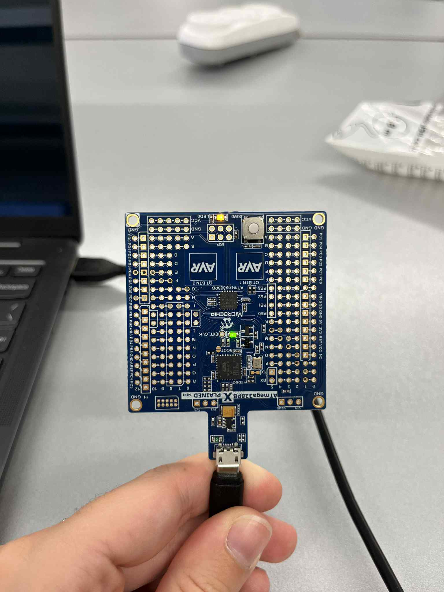

# Lab 1: Blink an LED

The "hello world" of embedded systems: blink the board's built-in LED by writing to the AVR's I/O registers directly.

## How it works

- `DDRB |= (1 << DDB5);` makes pin **PB5** (the built-in LED) an output.
- In an endless loop, the code sets PB5 high (LED on), waits 100 ms, sets it low (LED off), and waits 100 ms.
- `F_CPU` is set to 16 MHz so `_delay_ms()` waits the right amount of time.

## Result

| LED on | LED off |
|---|---|
|  |  |

## Build

Microchip Studio → new GCC C Executable project → device **ATmega328PB** → replace `main.c` → build and program the board over USB.
